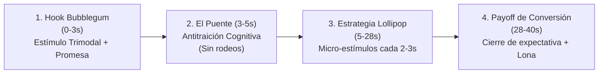

# Retention Engine + TRIBE v2 (Meta FAIR)

Framework integral de **neuro-retención en vídeo corto** que fusiona:
1. **La base neurocientífica computacional:** El modelo fundacional **TRIBE v2** (*TRImodal Brain Encoder v2*, desarrollado por **Meta FAIR** y la **ENS Paris**, `arXiv:2605.04326`), entrenado con más de 1.100 horas de resonancia magnética funcional (fMRI) en más de 720 sujetos para predecir la respuesta cortical humana ante estímulos de vídeo, audio y lenguaje.
2. **La ingeniería de guionizado de alto impacto:** La fórmula de los 3 actos de retención (Hook Bubblegum, Estrategia Lollipop y Payoff de Conversión), diseñada para mantener enganchado al espectador durante más de 30 segundos y convertir visitas en comunidad para **Lona** y proyectos de nicho.

---

## 1. Fundamento Científico: ¿Por qué el algoritmo es el cerebro?

> **«El algoritmo de Meta no mide solo likes o audios en tendencia: es un gemelo digital del cerebro del espectador.»**

Meta FAIR demostró que la atención humana ante un vídeo no se fragmenta en elementos aislados, sino que activa de forma sincronizada tres áreas cerebrales clave:
* **Córtex Visual (V1, V2, MT):** Detecta cambios de plano, movimiento y contraste (modelado en TRIBE v2 mediante `Video-JEPA 2`).
* **Córtex Auditivo (A1, STG):** Procesa entonación de voz, silencios y sonidos de impacto (modelado mediante `Wav2Vec-BERT`).
* **Córtex Lingüístico (Wernicke, IFG):** Decodifica significado, expectativas y coherencia narrativa (modelado mediante `LLaMA 3.2`).

Cuando un vídeo presenta una discrepancia o decae en estimulación, el modelo predice un **colapso de oxigenación cortical (caída hemodinámica)** que en la vida real se traduce en el gesto de deslizar el pulgar (*swipe*).

---

## 2. La Fórmula de los 3 Actos de Retención



### Acto 1: El Hook "Bubblegum" (0 a 3 segundos)
* **Objetivo:** Estimular el córtex visual y auditivo primario sin generar sobrecarga ni recurrir a engaños baratos.
* **Mecánica:** Presentar un dolor específico, un error común o una creencia contraria visceral:
  * *Ejemplo:* «Si cuando tiras el cruzado tu pie derecho se levanta así, te estás dejando noqueado tú solo.»
* **El pecado capital (La Traición Cognitiva):** El retardo hemodinámico cerebral es de ~5 segundos. Si los segundos 3 a 5 no conectan inmediatamente con la promesa del gancho, el lóbulo frontal detecta incoherencia y el usuario abandona.

### Acto 2: La Estrategia "Lollipop" (5 a 28 segundos)
* **Metáfora:** *«Vienen por la menta (el hook), pero se quedan por el chocolate (la sustancia técnica/emocional).»*
* **Mecánica:** El cerebro se habitúa a un estímulo constante a los 2,5 segundos. Para evitar la habituación neuronal, debe introducirse una **micro-renovación cada 2–3 segundos**:
  1. Cambio de plano de cámara (cenital, detalle, medio).
  2. Efecto sonoro de apoyo (impacto de golpe, sonido de velcro, crujido).
  3. Contraste de información («pero espera, esto no es lo peor...»).
  4. Demostración práctica en directo.

### Acto 3: El Payoff de Conversión (28 a 40+ segundos)
* **Objetivo:** Activar la consolidación de memoria (Default Mode Network) mediante la satisfacción de la promesa inicial.
* **Mecánica:**
  1. **Solución contundente:** Dar la clave maestra resolviendo el dolor del inicio.
  2. **Conversión orgánica:** Presentar la comunidad de forma natural:
     * *Para Lona:* «Si buscas un gimnasio en tu ciudad donde te enseñen técnica de verdad y no solo a sudar, entra a **lonaclub.es**.»

---

## 3. Repositorio TRIBE v2 Integrado (`tribev2/`)

El repositorio oficial de Meta FAIR se encuentra completamente incorporado dentro de esta skill en el directorio `tribev2/`:
* `tribev2/model.py`: Arquitectura Transformer multimodal hacia fsaverage5.
* `tribev2/demo_utils.py`: Clase `TribeModel` para inferencia directa desde archivos `.mp4`, `.wav` o `.txt`.
* `tribev2/plotting/`: Renderizado 3D de la activación en la superficie cortical.
* `references/tribev2-neuroscience.md`: Documento técnico exhaustivo con especificaciones y citaciones del paper.

### Inferencia in-silico con TRIBE v2:
```python
from tribev2.demo_utils import TribeModel

# Cargar modelo desde Hugging Face
model = TribeModel.from_pretrained("facebook/tribev2")

# Extraer eventos de vídeo/audio/texto y predecir mapas corticales
events = model.get_events_dataframe(video_path="mi_video.mp4")
predictions, segments = model.predict(events=events)
print("Vértices corticales predichos:", predictions.shape)
```

---

## 4. Herramienta de Auditoría Rápida (`scripts/audit_script.py`)

Para evaluar guiones antes de grabar sin requerir GPU pesada, la skill incluye un analizador que comprueba la densidad de estímulos, la presencia del puente antitraición y el cierre de conversión:

```bash
python .agents/skills/retention-engine/scripts/audit_script.py ruta/a/tu_guion.md
```

---

## 5. Plantillas Prácticas para LONA (Deportes de Contacto)

### Plantilla: El Desmontaje Anatómico (38s)
* **0-3s (Hook):** «Si te pones 10 vueltas en los nudillos porque crees que la venda es para amortiguar el golpe... te vas a romper la mano.»
* **4-6s (Puente antitraición):** Demostración visual de la muñeca doblándose al empujar la palma. «La venda es una escayola, no un cojín.»
* **7-26s (Lollipop cada 2.5s):** 
  - *7s:* Error del 90% (gastar toda la venda en la almohadilla).
  - *12s:* Paso 1: abrir bien los dedos con tensión para no cortar circulación.
  - *18s:* Paso 2: 60% de la venda en el puente muñeca-carpo en 'X'.
  - *23s:* Prueba del sonido (velcro + golpe seco palma-puño).
* **27-38s (Payoff):** «Guarda este vídeo antes de meter la mano en el guante. Y si buscas clubes donde te enseñen técnica real, encuéntralos en **lonaclub.es**.»

---

## 6. Checklist de Validación Neurocognitiva
- [ ] **Gancho trimodal (0-3s):** ¿Hay un estímulo visual llamativo y una frase contraria al consenso?
- [ ] **Sin traición (4-5s):** ¿El segundo 4 demuestra de inmediato lo prometido sin saludos ni preámbulos?
- [ ] **Ritmo Lollipop (5-28s):** ¿Hay al menos un cambio de ángulo, sonido o giro narrativo cada 2.5–3 segundos?
- [ ] **Neuro-recompensa (28-35s):** ¿Se resuelve el dolor del espectador antes del llamado a la acción?
- [ ] **Voz humana (anti-slop):** ¿El tono suena a entrenador real de gimnasio (cero clichés corporativos de IA)?
